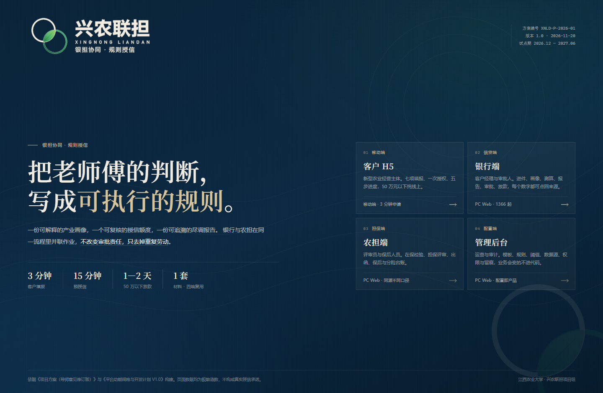

# 兴农联担 · 银担协同智能授信平台（高保真原型）

面向新型农业经营主体的银担协同授信平台演示原型，以江西赣南脐橙、遂川油茶、临川竹荪为产业样本。

> 本仓库为静态演示原型，全部数据为脱敏造数，不接入真实银行、农担或政务系统，不构成真实授信承诺。



## 在线访问

<https://lhn-lei.github.io/xingnong-liandan/>

入口为单文件 `index.html`，无构建、无 CDN、无外部依赖；样式、脚本、Logo 均已内联，可离线双击打开。

## 四端十二场景

- **客户 H5**：五步旅程（扫码申请 → 模板匹配 → 画像核验 → 并联审批 → 放款陪伴），底部四个页签可切换
- **银行端**：工作台、进件任务池、申请详情六页签（概览 / 产业画像 / 额度测算 / 尽调报告 / 流程留痕 / 材料）
- **农担端**：工作台、担保评审、保后台账与保后预警
- **管理后台**：产业模板编辑器、规则与灰度、数据源目录、审计日志

## 可交互规则

- 封面四张角色卡直达对应端；每一端均可“切换角色”回到封面
- 手机端五步可点击、可“下一步”推进、可回到第一步重玩
- 银行工作台导出经营报表、新建进件；进件池全选 / 逐行勾选 / 批量认领 / 搜索 / 产业筛选 / 导出 CSV
- 申请详情：画像字段可溯源；额度公式 `min(近三年平均销售收入×0.56, 亩数×亩均投入×系数, 300万)` 随系数实时重算，人工调额须填理由
- 审批 S08 → S09 / 退回 S06：状态药丸、流程留痕、按钮禁用态同步更新
- 尽调报告可重新生成、导出；材料可预览、下载副本
- 担保评审：建议结论、额度、费率、反担保可保存；担保函金额联动，出具后生成编号并置灰
- 模板编辑器：三套产业模板可切换、可复制；改参数时三组样例试算与规则包 JSON 实时联动；发布进入版本表
- 规则灰度：版本对比弹层、灰度比例保存、回滚、新建变更单，并在“近期变更单”卡片回看
- 数据源目录：登记新数据源会追加表格行，调用留痕可查、质量报告可下载
- 审计日志：类型筛选、关键字搜索、日期过滤、重置、申请导出与 CSV 下载
- 保后台账：导出 CSV；保后工单可标记核查，待办列表随之减少

## 设计

主色取自 Logo：海军蓝 `#0A2338 / #0E2D47 / #123A5C`、品牌绿 `#2F8A5B / #26744C`，纸底为暖米白 `#F2EEE4`；铜金只用于文件与印章级点缀。

Logo 已做透明处理，不使用白色底板：浅色界面用深色字标版，深色封面与侧栏用暖白反白版，图形标单独用于水印与 favicon。标题用宋体，数据用等宽数字；直角卡片、发丝线表格、低阴影，全站内联 SVG 图标，无 emoji、无外部字体。

## 工程结构

```
平台原型/
├── index.html
├── assets/
│   ├── style.css
│   ├── data.js
│   ├── app.js
│   └── logo-*.png
└── README.md
```

技术栈为原生 HTML / CSS / JavaScript，无构建步骤。若进入真实开发，可按规格第 2 章替换为 Vue 3 + TypeScript + Element Plus / Vant 4，后端 Java 17 + Spring Boot 3.2。

## 说明

原型依据《兴农联担_导师意见修订版_20261120.docx》与《兴农联担平台_功能规格与开发计划_V1.0.docx》构建，用于课程与项目评审演示。
